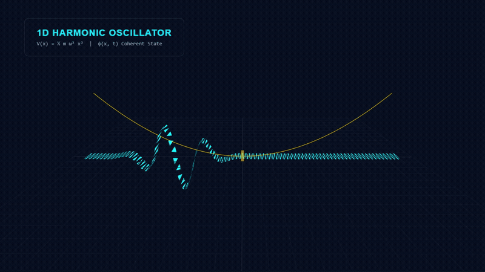
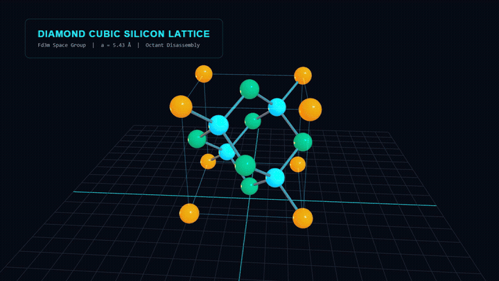
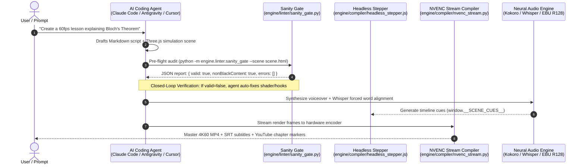
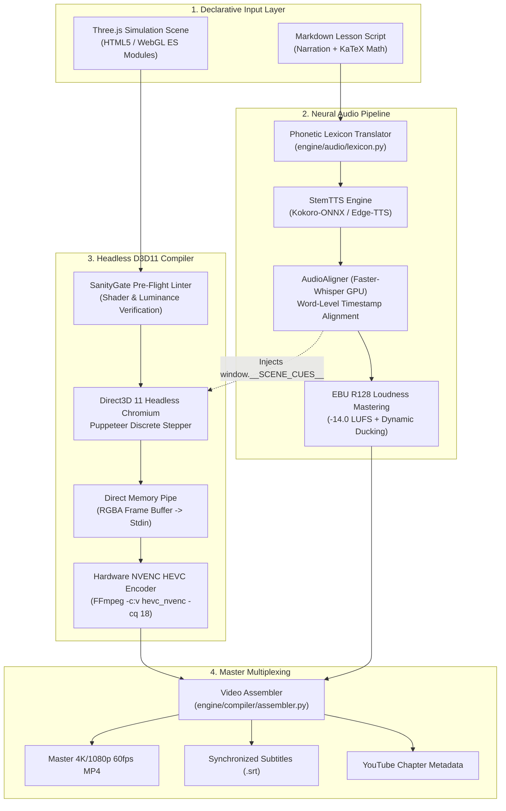

# IntuiSim: Cinema-Grade STEM Documentary Production Engine

[](https://python.org)
[](https://nodejs.org)
[](https://threejs.org)
[](https://nvidia.com)
[-purple.svg)](https://tech.ebu.ch)
[](#built-for-autonomous-ai-coding-agents)
[](LICENSE)

**IntuiSim** is an open-source, cinema-grade STEM documentary simulation and video production engine. It translates mathematical physics, semiconductor crystallography, and scientific phenomena into 60fps ultra-luxury video masterclasses with zero human post-production required.

Designed from the ground up for both human engineers and **autonomous AI coding agents**, IntuiSim provides deterministic time stepping, closed-loop WebGL verification gates, GPU-accelerated neural voice synthesis, and direct-memory NVENC hardware video encoding.

---

## Visual Showcase: What IntuiSim Creates

IntuiSim renders publication-grade 3D simulations directly from declarative code and markdown scripts. Below are sample 60fps simulation sequences rendered deterministically frame-by-frame:

| 1. Quantum Wavepacket Dispersion (`WavepacketField.js`) | 2. Silicon Crystal Octant Disassembly (`DiamondCubicUnitCell.js`) |
| :---: | :---: |
|  |  |
| *1D Coherent quantum wavepacket oscillating in a parabolic potential well with real-time HUD telemetry.* | *Diamond cubic crystal lattice ($Fd\bar{3}m$, $a = 5.43\text{ \AA}$) undergoing dynamic octant disassembly.* |

---

## Built for Autonomous AI Coding Agents

IntuiSim is engineered as an **agent-native execution environment**. Any modern AI coding assistant or autonomous agent framework can script, verify, and render complete scientific documentaries without human intervention:

- **Claude Code** (Anthropic)
- **Google Antigravity & Gemini CLI** (Google DeepMind)
- **Codex & ChatGPT Advanced Agents** (OpenAI)
- **Cursor & Windsurf** (Agentic pair programmers)
- **OpenCode & Open-Source Agent Harnesses** (AutoGPT, LangGraph, CrewAI)



### Why AI Agents Excel with IntuiSim
1. **Deterministic Closed-Loop Feedback:** The built-in `SanityGate` (`engine/linter/sanity_gate.py`) provides structured JSON receipts (`valid`, `hasNonBlackContent`, `errors`). If an agent introduces a WebGL syntax error or black frame, it receives immediate actionable feedback to heal the code before spending GPU cycles on rendering.
2. **Modular Primitive Composition:** Agents do not need to invent complex 3D math or raw shader code from scratch. They import battle-tested components (`LatticeBuilder`, `OctantClipper`, `WavepacketField`, `TopographicSurface3D`) and wire them to simulation parameters.
3. **Discrete Time Stepping:** Because the engine steps time discretely via `window.__RENDER_FRAME(t)`, agents never encounter race conditions, dropped frames, or hardware timing jitter.

---

## Architecture & Subsystems



### Core Pipeline Breakdown

| Subsystem | Key Components | Technical Implementation |
| :--- | :--- | :--- |
| **Compiler & Stepper** | `engine/compiler/headless_stepper.js`<br/>`engine/compiler/nvenc_stream.py` | Direct3D 11 Angle hardware acceleration inside headless Chromium. Evaluates discrete frame increments (`window.__RENDER_FRAME(k / fps)`), piping raw frame buffers directly to NVENC with zero disk caching. |
| **Audio Synthesis** | `engine/audio/tts.py`<br/>`engine/audio/lexicon.py` | Local Kokoro ONNX model with multi-voice vector blending (`calm_professor`, `documentary_cinematic`) and Microsoft Edge-TTS neural fallback. Custom regex lexicon translates Greek physics symbols and KaTeX math into natural spoken prosody. |
| **Forced Alignment** | `engine/audio/aligner.py`<br/>`engine/audio/subtitles.py` | Faster-Whisper GPU model transcribes synthetic audio, mapping exact word boundaries $[t_{\text{start}}, t_{\text{end}}]$ to frame indices. Outputs valid SubRip (`.srt`) captions and timeline cues. |
| **Broadcast Mastering**| `engine/audio/mastering.py` | Conforms audio stems to international EBU R128 loudness standards (`-14.0 LUFS`, $-1.0\text{ dBFS}$ true peak), applying dynamic $-16\text{ dB}$ sidechain ducking under voiceover. |
| **Quality Linter** | `engine/linter/sanity_gate.py` | Headless pre-flight auditor checking canvas resolution, WebGL context creation, animation hook availability, and non-black pixel luminance. |
| **3D Math Primitives** | `engine/primitives/*`<br/>`assets/structures/*` | Reusable Three.js ES modules: `LatticeBuilder`, `DiamondCubicUnitCell`, `WavepacketField`, `PotentialWellTerrain`, `OctantClipper`, `TopographicSurface3D`. |

---

## Scene Blueprint Contract

Every IntuiSim visual scene is a self-contained HTML file running Three.js. To guarantee deterministic 60fps rendering without frame drops, scenes implement two global hooks:

```javascript
// 1. Advance simulation state to exact target time (in seconds)
window.__RENDER_FRAME = function(t) {
  // Update camera choreography
  camera.position.x = Math.sin(t * 0.5) * 15.0;
  camera.lookAt(0, 0, 0);

  // Update physical simulation / primitives
  wavepacket.step(t);
  crystalLattice.setExplosion(Math.sin(t));

  // Render WebGL frame
  renderer.render(scene, camera);
};

// 2. Signal to Headless Stepper that shaders & textures are compiled
window.__SCENE_READY = true;
```

---

## Quickstart

### Prerequisites
- **Operating System:** Windows 10/11 x64 (Direct3D 11 support) or Linux with hardware rendering.
- **GPU:** NVIDIA GPU with Turing/Ampere/Ada NVENC hardware encoder (GTX 1660, RTX 2060, RTX 30/40/50 series) or software H.264 fallback.
- **Python:** 3.10+ (64-bit).
- **Node.js:** 20.x or 24.x LTS.
- **FFmpeg:** 6.0+ on system `PATH` with `hevc_nvenc` support.

### 1. Installation
```powershell
git clone https://github.com/Minhaj009/IntuiSim.git
cd IntuiSim

# Set up Python virtual environment
python -m venv .venv
.\.venv\Scripts\Activate.ps1
pip install -r requirements.txt

# Install Node dependencies (Puppeteer)
npm install
```

### 2. Download Neural Models
Fetch Kokoro ONNX model weights and voice vectors:
```powershell
python scripts/download_models.py
```
*(Faster-Whisper speech models are automatically fetched and cached locally on first alignment run).*

### 3. Run the Demos

#### Demo 1: Quantum Harmonic Oscillator
Validate the headless WebGL frame stepper:
```powershell
python examples/demo_harmonic_oscillator/render_demo.py --mode lint
```
Capture a 1080p snapshot keyframe:
```powershell
python examples/demo_harmonic_oscillator/render_demo.py --mode snapshot
```
Render a hardware-encoded MP4 clip:
```powershell
python examples/demo_harmonic_oscillator/render_demo.py --mode stream --duration 6.0
```

#### Demo 2: Diamond Cubic Crystal Lattice Disassembly
Render 6 seconds of silicon unit cell octant disassembly:
```powershell
python -c "from engine.compiler.nvenc_stream import NvencStreamCompiler; from pathlib import Path; c = NvencStreamCompiler(); c.render_scene(Path('examples/demo_crystal_lattice/scene.html'), Path('demo_lattice.mp4'), duration=6.0, fps=30, width=1920, height=1080)"
```

---

## Reusable 3D Mathematical Primitives

IntuiSim ships with modular Three.js primitives optimized for technical scientific visualization:

- **`WavepacketField`** (`engine/primitives/WavepacketField.js`): 1D and 2D quantum wavepackets with Gaussian envelopes, dispersion kinetics, and phase interference fringes.
- **`DiamondCubicUnitCell`** (`assets/structures/DiamondCubicUnitCell.js`): Watertight semiconductor crystallography with exploded octant disassembly rails, covalent bonds, and space group symmetry.
- **`PotentialWellTerrain`** (`assets/structures/PotentialWellTerrain.js`): 3D deformable Kronig-Penney potential landscapes with cryogenic-to-ambient thermal color shifts (0 K to 300 K).
- **`LatticeBuilder`** (`engine/primitives/LatticeBuilder.js`): Procedural 14 Bravais lattice generator supporting FCC, BCC, SC, and diamond cubic coordinates.
- **`OctantClipper`** (`engine/primitives/OctantClipper.js`): Dynamic CSG solid-geometry cutting planes for inspecting interior crystal geometries.
- **`SplineTransducerHUD`** (`engine/primitives/SplineTransducerHUD.js`): Mathematical telemetry displays with glowing spline curves, live coordinate readouts, and scale reticles.
- **`VectorFieldParticles`** (`engine/primitives/VectorFieldParticles.js`): GPU particle streamlines visualizing electromagnetic flux and gradient vector fields.

---

## Configuration & Environment Variables

Create a `.env` file in the project root (see [.env.example](.env.example)):

```bash
# Optional: Project root directory override
INTUISIM_ROOT=F:/IntuiSim

# Optional: Path to custom Google Chrome / Chromium executable
CHROME_PATH="C:/Program Files/Google/Chrome/Application/chrome.exe"

# Faster-Whisper execution device ('cuda' or 'cpu')
WHISPER_DEVICE=cuda
WHISPER_COMPUTE_TYPE=float16

# FFmpeg hardware acceleration ('cuda' or 'cpu' fallback)
FFMPEG_HWACCEL=cuda
```

---

## Repository Layout

```text
IntuiSim/
├── assets/
│   ├── audio/              # Sound bank generators & background stems
│   ├── fonts/              # Bundled monospace and math fonts
│   ├── models/             # Kokoro ONNX & Whisper weights (.gitkeep)
│   ├── structures/         # Crystalline structures & potential landscapes
│   ├── templates/          # Headless blueprint HTML template
│   └── vendor/             # Bundled Three.js r169 module & shaders
├── docs/
│   └── media/              # Visual showcase animations & diagrams
├── engine/
│   ├── audio/              # TTS, alignment, subtitles, mastering
│   ├── compiler/           # D3D11 stepper, NVENC stream compiler, assembler
│   ├── linter/             # SanityGate WebGL pre-render validator
│   ├── packaging/          # YouTube metadata & chapter marker generator
│   ├── primitives/         # Three.js 3D mathematical primitives
│   └── orchestrator.py     # Master compilation pipeline CLI
├── examples/
│   ├── demo_harmonic_oscillator/ # 1D wavepacket demo scene & runner
│   └── demo_crystal_lattice/     # Diamond cubic lattice disassembly demo
├── scripts/
│   └── download_models.py  # Model downloader utility
├── ARCHITECTURE.md         # Detailed architectural invariants & ADRs
├── CONTRIBUTING.md         # Contribution guidelines
├── LICENSE                 # MIT License
├── package.json            # Node.js dependencies (Puppeteer)
├── requirements.txt        # Python dependencies
└── SPEC.md                 # System functional specification
```

---

## Contributing

We welcome contributions from researchers, educators, Three.js developers, and AI engineers. Please see [CONTRIBUTING.md](CONTRIBUTING.md) for details on submitting new mathematical primitives, shaders, or audio improvements.

---

## License

IntuiSim is open-source software released under the [MIT License](LICENSE).
