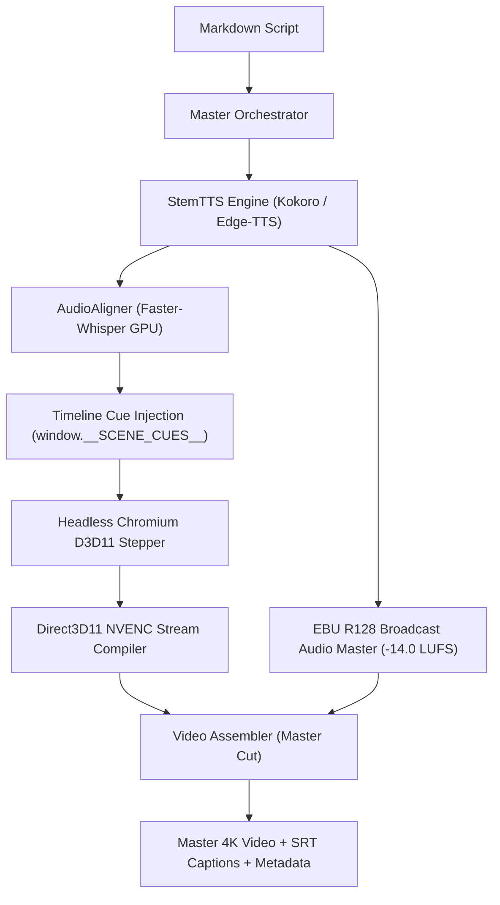

# IntuiSim: Cinema-Grade STEM Documentary Production Engine

[](https://python.org)
[](https://nodejs.org)
[](https://threejs.org)
[](https://nvidia.com)
[](https://tech.ebu.ch)
[](LICENSE)

IntuiSim is an open-source, cinema-grade STEM documentary production engine. It translates mathematical physics, semiconductor crystallography, and scientific phenomena into 60fps ultra-luxury video masterclasses with zero human post-production required.



## Core Features

- **Headless Three.js Stepper:** Puppeteer orchestrates headless Chromium with Direct3D 11 Angle hardware acceleration, evaluating deterministic frame times (`window.renderFrame(t)`) and streaming uncompressed PNG frames.
- **Direct Memory-Piped NVENC Encoding:** Pipes Chromium frame buffers directly into FFmpeg NVIDIA NVENC (`hevc_nvenc`) with `-cq 18` and `-preset p5`. Delivers 60fps rendering faster than real time with zero disk frame caching.
- **Whisper Subtitle Alignment:** GPU-accelerated Faster-Whisper transcribes synthesized speech, extracting frame-accurate word timestamps to drive synchronized 3D geometric state transitions.
- **EBU R128 Audio Mastering:** Dual-stage loudness normalization conformed to `-14.0 LUFS` with automatic `-16 dB` sidechain ducking of background acoustic beds under active speech.
- **Dynamic Geometric Disassembly:** Procedural 3D clipping primitives (octant wedge clippers, topographic energy surfaces, vector flow fields) illustrate complex spatial symmetries.

## Architecture & Subsystems

- `engine/orchestrator.py`: Pipeline coordinator parsing scripts, managing audio synthesis, visual rendering, and bumper assembly.
- `engine/audio/`: Neural TTS (`Kokoro-ONNX`, `Edge-TTS`), STEM phonetic lexicon, Faster-Whisper aligner, and EBU R128 mastering.
- `engine/compiler/`: Direct3D 11 Puppeteer stepper (`headless_stepper.js`) and direct-memory NVENC stream encoder (`nvenc_stream.py`).
- `engine/linter/`: Automated canvas validator (`sanity_gate.py`) checking WebGL execution, hook contracts, and frame luminance.
- `engine/primitives/`: Reusable Three.js physical components (`LatticeBuilder`, `OctantClipper`, `TopographicSurface3D`, `WavepacketField`).
- `scripts/`: Offline model management and setup utilities.
- `examples/`: Minimal reproducible standalone simulation demos.

## Quickstart

### Prerequisites
- **Operating System:** Windows 10/11 x64 (Direct3D 11 support).
- **GPU:** NVIDIA GPU with Turing/Ampere/Ada NVENC hardware encoder (GTX 1660, RTX 2060+).
- **Python:** 3.10+ (64-bit).
- **Node.js:** 20.x or 24.x LTS.
- **FFmpeg:** 6.0+ on system `PATH` with `hevc_nvenc` support.

### 1. Installation
```powershell
git clone https://github.com/Minhaj009/IntuiSim.git
cd IntuiSim

python -m venv .venv
.\.venv\Scripts\Activate.ps1
pip install -r requirements.txt
npm install
```

### 2. Download Offline Models
Fetch Kokoro ONNX model weights and voice vectors:
```powershell
python scripts/download_models.py
```
*(Faster-Whisper speech models will download and cache automatically on initial execution).*

### 3. Run Verification Demo
Validate the headless WebGL frame stepper on the Harmonic Oscillator demo:
```powershell
python examples/demo_harmonic_oscillator/render_demo.py --mode lint
```
Capture a 1080p snapshot keyframe:
```powershell
python examples/demo_harmonic_oscillator/render_demo.py --mode snapshot
```
Render a 3-second hardware-encoded MP4 clip:
```powershell
python examples/demo_harmonic_oscillator/render_demo.py --mode stream --duration 3.0
```

## Repository Layout

```text
IntuiSim/
├── assets/
│   ├── audio/              # Sound bank generators & background stems
│   ├── brand/              # Universal intro/outro bumpers & logos
│   ├── models/             # Kokoro ONNX & Whisper weights
│   └── vendor/             # Bundled Three.js r169 module & shaders
├── engine/
│   ├── audio/              # TTS, alignment, subtitles, mastering
│   ├── compiler/           # D3D11 stepper, NVENC stream compiler, assembler
│   ├── linter/             # Sanity gate WebGL pre-render linter
│   ├── packaging/          # Metadata and chapter generation
│   ├── primitives/         # Three.js 3D mathematical primitives
│   └── orchestrator.py     # Master compilation CLI
├── examples/
│   └── demo_harmonic_oscillator/ # 1D wavepacket demo scene & runner
├── scripts/
│   └── download_models.py  # Model downloader utility
├── package.json
├── requirements.txt
└── README.md
```

## License

IntuiSim is released under the [MIT License](LICENSE).
